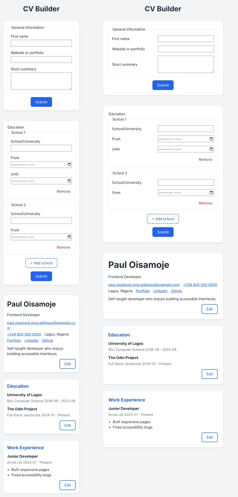

# CV Builder

A React app for building a simple CV. Fill in your general information, education and work experience, submit each section to see it laid out as a CV, and click Edit to change it at any time.

**Live page:** _add your Vercel link here_



## Features

- Three sections: General information, Education and Work experience
- Edit and submit each section on its own
- Add or remove as many schools and jobs as you need
- Responsibilities typed on separate lines display as a bulleted list
- Responsive layout for phones, tablets and desktops

## Built with

- [React](https://react.dev/)
- [Vite](https://vite.dev/)
- CSS (Grid, Flexbox, subgrid, media queries)

## Running it locally

```
npm install
npm run dev
```

| Command           | What it does                            |
| ----------------- | --------------------------------------- |
| `npm run dev`     | Starts the development server           |
| `npm run build`   | Creates the production build in `dist/` |
| `npm run preview` | Serves the production build locally     |
| `npm run lint`    | Checks the code with ESLint             |

## About this project

This is [The Odin Project's CV Application project](https://www.theodinproject.com/lessons/node-path-react-new-cv-application) from the React course.
